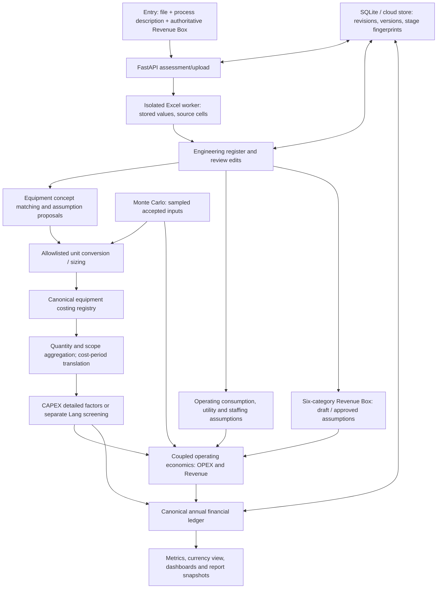

# System architecture — observed baseline

Audit date: 2026-11-10. Repository: `FlowValue-latest`, commit `74f364d2ebdcbc67bd0732937f59ef6a3704dce3`, branch `main`. The ambient older `Chemical Engineering Automation` directory is not this checkout. No deployment or production data changes were made.

## Implemented pathway

This diagram describes executable interfaces, not a claim that an arbitrary workbook automatically yields complete results. Individual stages can run independently with declared prerequisites. `backend/blocks/registry.py` declares equipment→engineering_data, CAPEX→equipment, Revenue/OPEX→engineering_data, finance→CAPEX+Revenue+OPEX. Optional capital/revenue-dependent OPEX bases are resolved through operating economics; missing values remain partial.

| Layer | Actual source | Observation |
|---|---|---|
| Browser | `frontend/src/app/`, `frontend/src/components/` | Next 16.4.3, React 19.3; build passed. Pages consume assessment/stage outputs and open editable drawers. |
| API | `backend/api/app.py` | Upload, stage execution, approvals, revisions, versions, currency, snapshots, Monte Carlo. Local origin guard and cloud bearer verification are different modes. |
| Ingestion | `backend/orchestration/ingest.py`; `backend/ingestion/worker.py`; `backend/ingestion/balance/` | Current upload adapter explicitly accepts xlsx/xls/xlsm; 20 MiB, 30-second worker deadline, bounded workbook/archive/cell reading. Does not calculate Excel formulas or execute macros. |
| AI | `backend/orchestration/provider.py`, `analyst_team.py`, `workbook_review.py`; `backend/equipment_matching/service.py` | Structured interpretation, conceptual model selection and assumption proposals. Tests use fake providers; no live provider calls were made. |
| Units/sizing | `backend/equipment_costing/unit_conversion/`; `backend/engineering_sizing/` | Explicit measurement/context, allowlisted derivations. Parser normalization is an additional implementation needing parity checks. |
| Costing | `backend/equipment_costing/registry.py`, `total_cost/calculator.py` | Garrett, Nottingham, additional models, OpenPyTEA adapters; cost scope and unit provenance retained. Catalogue includes disabled configurations. |
| Economics | `backend/capex/`; `backend/opex/`; `backend/revenue/` | Typed deterministic calculations plus block-level connectors. Historical docstrings saying “offline only” are stale: block callers exist. |
| Finance | `backend/financial_modelling/engine.py` | Shared annual ledger, schedules, tax/depreciation/financing, investment and unit metrics. Other folders include support interfaces; a file count is not a feature count. |
| Persistence | `backend/orchestration/store.py`; `backend/cloud/store.py` | Local SQLite JSON/BLOB assessments, optimistic revision writes, named version copies; optional cloud workspace store. |
| Reporting | `backend/dashboard_reporting/study_report.py`; `backend/currency_conversion/assessment.py` | Saved result views and report/snapshot routes. Full browser/export reconciliation is not established by build success. |
| Uncertainty | `backend/scenarios_and_uncertainty/monte_carlo/` | Samples parameter distributions and reruns the shared deterministic pathway, no per-iteration LLM. |

## Planned or unverified pathways

The Scenario & Sensitivity page is a scaffold. Full R39 opportunity→stream mapping→opted-in research→reviewed scenario→all-view reconciliation remains acceptance work, not proven by that page. Interactive 2D/3D/digital twins, unrestricted simulator import and industrial accreditation are not demonstrated in this clean-slate checkout. Root AGENTS references old `backend/app/parsers/inputs/` stubs and older dependency manifests that are absent here; preserve requirements but do not infer support from stale documentation.

## Development baseline

Existing CI covered frontend only and ran four `.mjs` tests. Phase0 widens that command to include `.cjs` and adds a Python baseline job; no equation or coefficient changes. Historical acceptance files were not rewritten. See `baseline_test_report.md` for measured results and `data_flow_and_dependencies.md` for boundary risks.
